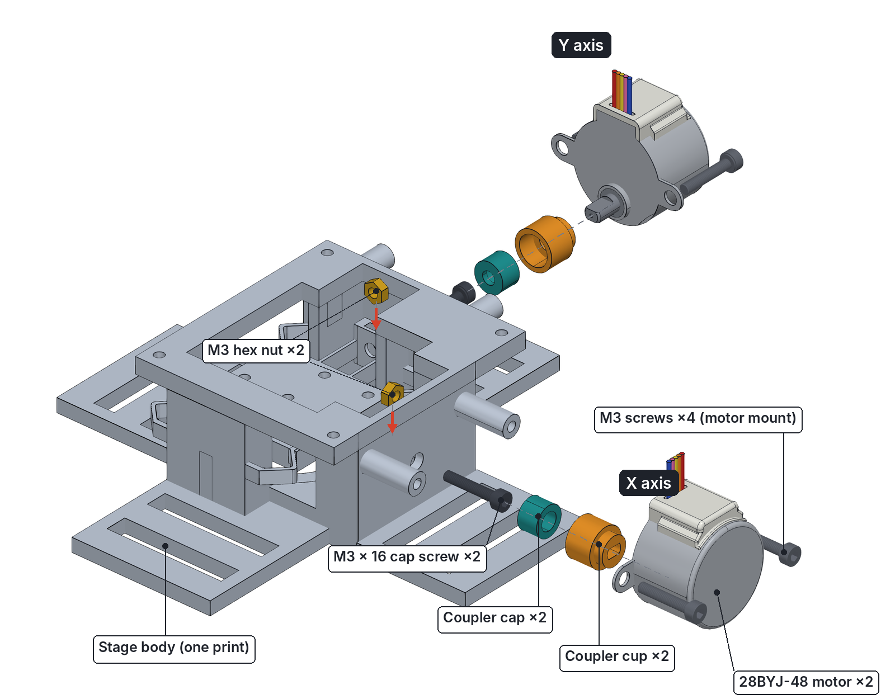
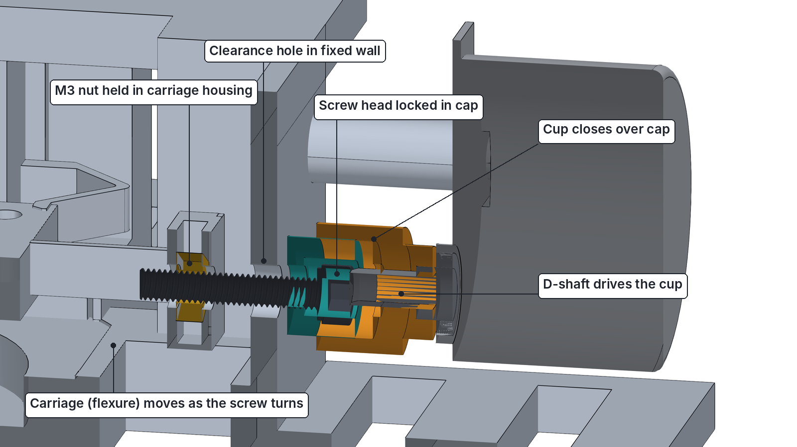
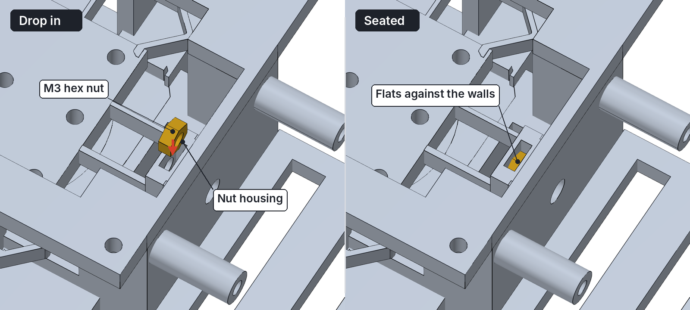
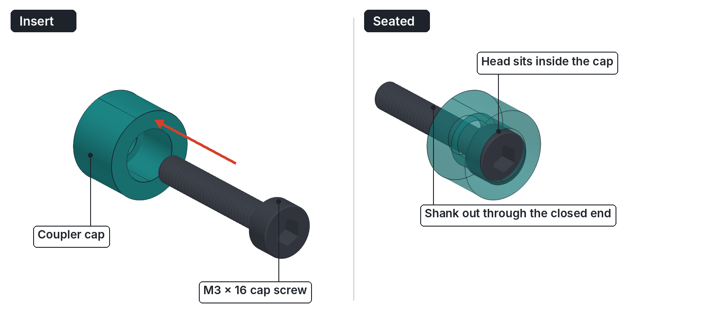
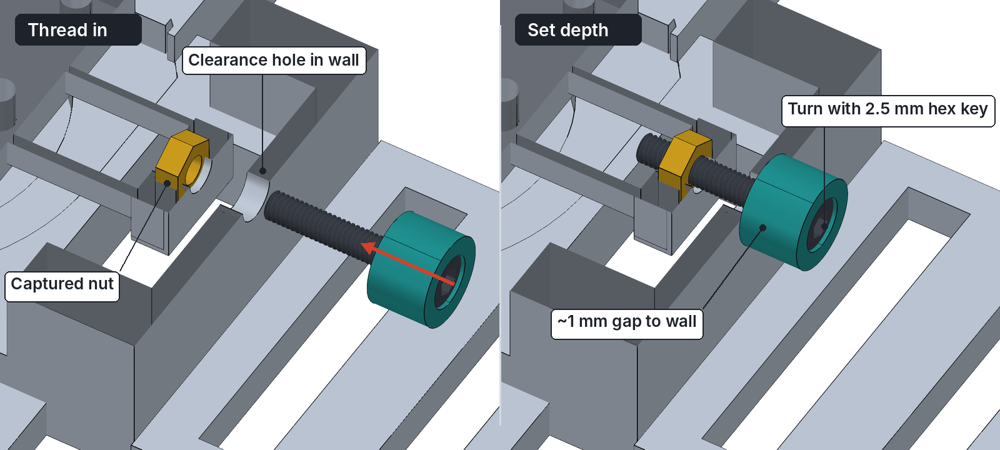
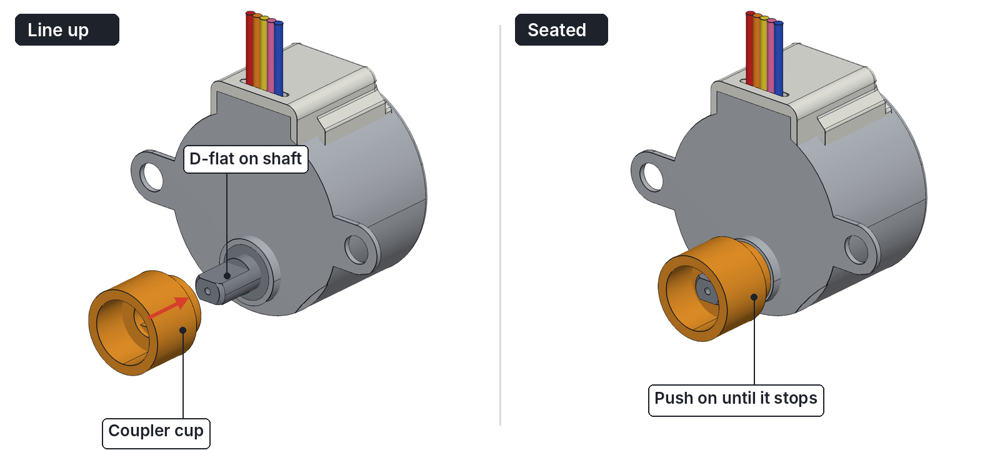
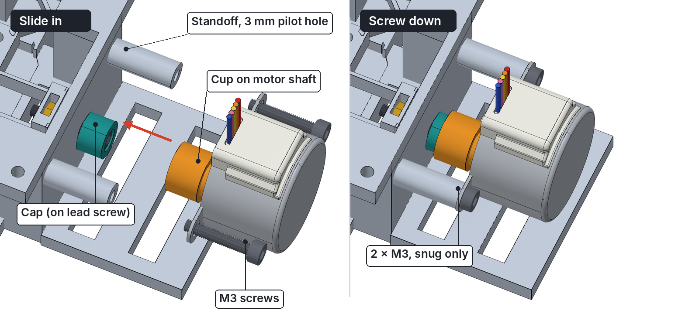
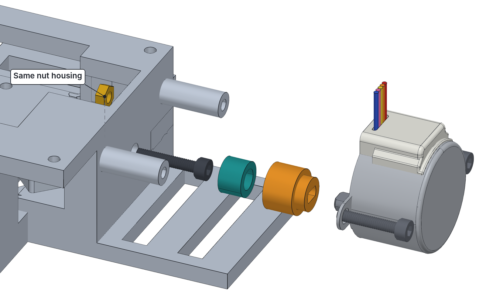
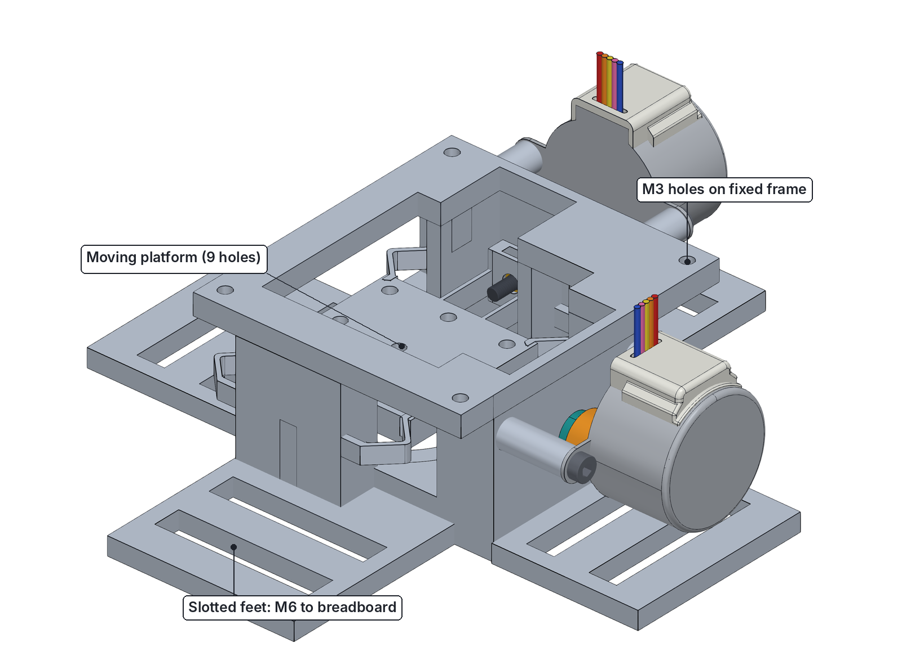

# XY Lab — Assembly Guide

Step-by-step instructions for assembling the **F²R XY Lab** flexure stage, with exploded views rendered from the full assembly CAD.

The X and Y axes are built the same way. Steps 1–5 show the X axis; Step 6 repeats them for Y.

**Time:** about 30 minutes, once the parts are printed and the motors are converted to bipolar (see the [README](README.md#step-2--convert-the-motors-to-bipolar)).

---

## Contents

1. [Parts and tools](#parts-and-tools)
2. [How the drive works](#how-the-drive-works)
3. [Step 1 — Drop the nuts into their housings](#step-1--drop-the-nuts-into-their-housings)
4. [Step 2 — Put the lead screw into the coupler cap](#step-2--put-the-lead-screw-into-the-coupler-cap)
5. [Step 3 — Thread the lead screw into the nut](#step-3--thread-the-lead-screw-into-the-nut)
6. [Step 4 — Push the coupler cup onto the motor](#step-4--push-the-coupler-cup-onto-the-motor)
7. [Step 5 — Mount the motor](#step-5--mount-the-motor)
8. [Step 6 — Repeat for the Y axis](#step-6--repeat-for-the-y-axis)
9. [Step 7 — Mount on the breadboard and check](#step-7--mount-on-the-breadboard-and-check)
10. [Troubleshooting](#troubleshooting)

---

## Parts and tools

### Printed parts (PETG)

| Qty | Part | Notes |
|---|---|---|
| 1 | Stage body | One print: fixed frame, flexures and moving platform together |
| 2 | Coupler cap | Small teal sleeve in the images. Holds the lead-screw head. |
| 2 | Coupler cup | Larger orange part. Has a D-shaped hole for the motor shaft. |

### Hardware

| Qty | Part | Used for |
|---|---|---|
| 2 | M3 × 16 socket head cap screw | Lead screws (one per axis) |
| 2 | M3 hex nut | Captured in the nut housings |
| 4 | M3 × 10 socket head cap screw | Motor mounting (2 per motor) |
| 2 | 28BYJ-48 stepper motor, converted to bipolar | Drives |
| 4+ | M6 screws | Fixing the feet to an optical breadboard (optional) |

### Tools

- 2.5 mm hex key (for M3 socket heads)
- Tweezers or small pliers
- Small flat screwdriver

---

## How the drive works

Each axis is a small leadscrew drive. The motor turns the lead screw; the nut, captured in the moving carriage, converts that rotation into a push or pull on the flexure.

Working from the stage outwards:

1. **M3 nut** sits in a slot in the moving carriage. It cannot turn, so when the screw turns, the carriage moves.
2. **Lead screw** (M3 × 16) passes through a clearance hole in the fixed wall without touching it.
3. **Coupler cap** holds the screw head.
4. **Coupler cup** closes over the cap from the motor side.
5. **Motor D-shaft** fits the D-shaped hole in the cup, so the motor turns the cup, cap and screw together.

The two-piece coupler is what lets you assemble the drive in stages: the screw and cap go into the stage first, and the motor and cup slide on afterwards.

---

## Step 1 — Drop the nuts into their housings

Each axis has a **nut housing**: a narrow slot in the moving carriage, open at the top, directly in line with the lead-screw hole.

1. Hold an M3 nut above the slot with its **flat sides facing the slot walls**. It only fits this way.
2. Drop it in and press it down. It is a tight fit; push it with a small flat screwdriver if needed.
3. Do the same for the second nut in the Y-axis housing.

> **Tip:** If the slot has stringing or a blob from printing, clean it out with a craft knife first. Forcing the nut past a blob can stress the flexure.

## Step 2 — Put the lead screw into the coupler cap

1. Hold the coupler cap with its **open end** facing you. The cap is a sleeve with a 5.5 mm pocket for the screw head and a 4 mm hole through its closed end.
2. Push the M3 × 16 screw in, **tip first**, so the shank comes out through the hole in the closed end and the **head sits in the pocket**.
3. Make one of these for each axis.

## Step 3 — Thread the lead screw into the nut

*The body is shown cut in half here so you can see the screw path.*

1. Push the screw tip through the **clearance hole in the fixed wall** until it reaches the nut.
2. Put the 2.5 mm hex key through the open end of the cap into the screw head, and turn **clockwise** to thread the screw into the nut.
3. Keep turning until there is a **gap of about 1 mm between the cap and the wall**.

The cap must not touch the wall. Any contact adds friction and stops the stage from moving cleanly.

> **If the screw won't catch the nut:** the slot is slightly deeper than the nut, so the nut can rest below the hole. Lift it gently with tweezers while you start the thread.

## Step 4 — Push the coupler cup onto the motor

1. Look at the motor shaft. It has two **flat sides** (a D-profile).
2. Line up the D-shaped hole in the cup with the flats on the shaft. The **open bore** of the cup faces away from the motor.
3. Push the cup on until it almost touches the round boss on the motor face.

It should be a firm push fit with no wobble. If it is too tight, see [Troubleshooting](#troubleshooting).

## Step 5 — Mount the motor

1. Bring the motor up to the stage, keeping it in line with the screw, so the **cup slides straight over the cap**.
2. The motor's two mounting tabs should land on the ends of the **two standoffs**.
3. Fasten each tab with an M3 × 10 screw into the 3 mm pilot hole in the standoff. Tighten until **snug only**: the screws cut their own thread in the PETG, and over-tightening will strip it.

> **If the motor tabs don't sit flat on the standoffs:** the lead screw depth is off. Remove the motor, turn the screw a quarter turn in or out (Step 3), and try again.

## Step 6 — Repeat for the Y axis

The Y axis uses exactly the same parts in the same order:

1. Nut into the Y housing (if you haven't already).
2. Screw into cap.
3. Screw through the wall into the nut, with a ~1 mm gap between the cap and the wall.
4. Cup onto the second motor.
5. Motor onto the Y standoffs with two M3 × 10 screws.

## Step 7 — Mount on the breadboard and check

1. Place the stage on your breadboard and fix the **slotted feet** with M6 screws. The slots let you slide the stage to line it up before tightening.
2. Gently press the **moving platform** (the centre plate with 9 holes) sideways in X and then Y. It should flex smoothly and spring back.
3. Wire the motors and run the first motion test in the [README](README.md#step-6--first-motion-test).

**Mounting points:**

- **Moving platform:** 9 holes, for whatever you want to move (a sample, a fibre tip).
- **Fixed frame:** 4 × 3 mm holes in the corners, for things that must stay still (a lens, a holder).

> Mount cameras and microscope optics to the **breadboard**, not to the stage, so motor vibration doesn't reach them.

---

## Troubleshooting

| Problem | Cause | Fix |
|---|---|---|
| Nut won't go into the slot | Tight fit, or print stringing | Clean the slot; press the nut in with a flat screwdriver |
| Screw won't catch the nut | Nut sitting below the hole | Lift the nut with tweezers while starting the thread |
| Cup won't go on the shaft | D-hole slightly undersized from printing | Make sure the flats line up; ease the hole with a needle file |
| Cup wobbles on the shaft | D-hole oversized | Reprint the cup, or add a thin strip of tape on the flat |
| Platform doesn't move or binds | Cap rubbing the wall | Back the screw out a quarter turn |
| Motor tabs don't sit flat | Lead screw at the wrong depth | Adjust the screw (Step 3) |
| Motor screws spin freely | Thread stripped in the standoff | Use a slightly longer screw, or reprint the body |
| Motor hums but the platform doesn't move | Wiring or driver settings | See the README [troubleshooting](README.md#troubleshooting) |

---

*Part of the [F²R XY Flexure Stages](README.md) project. Licensed under the F²R Hardware License v1.0.*
