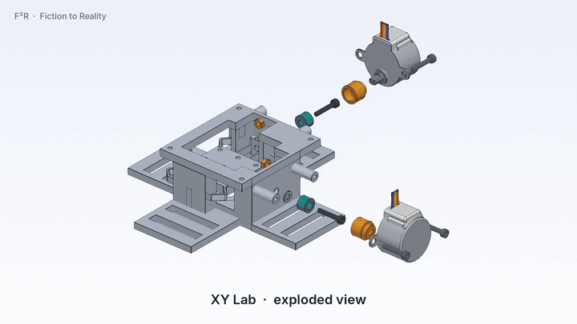
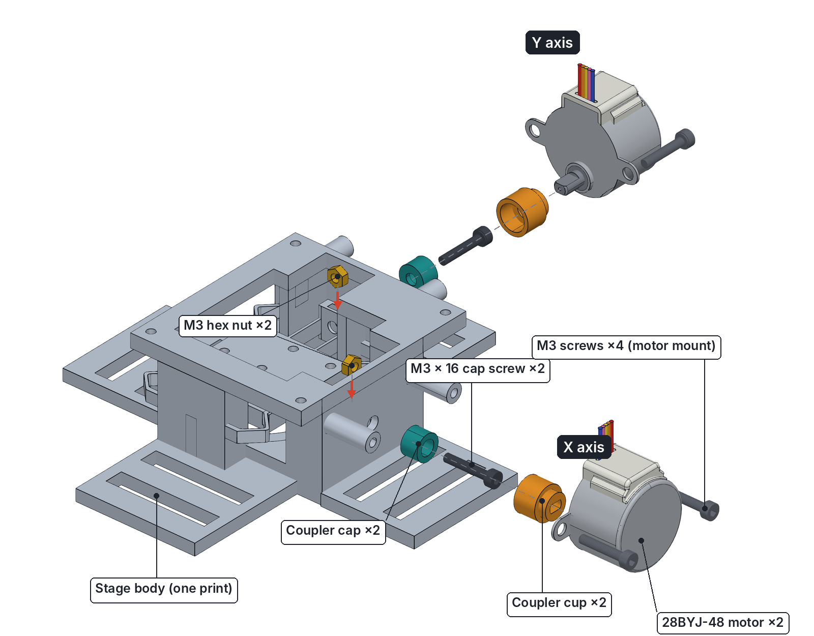
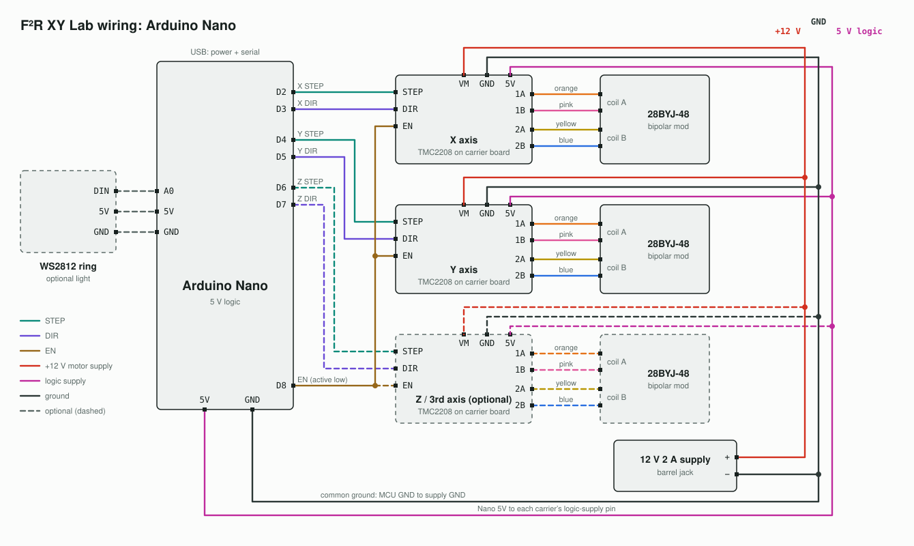
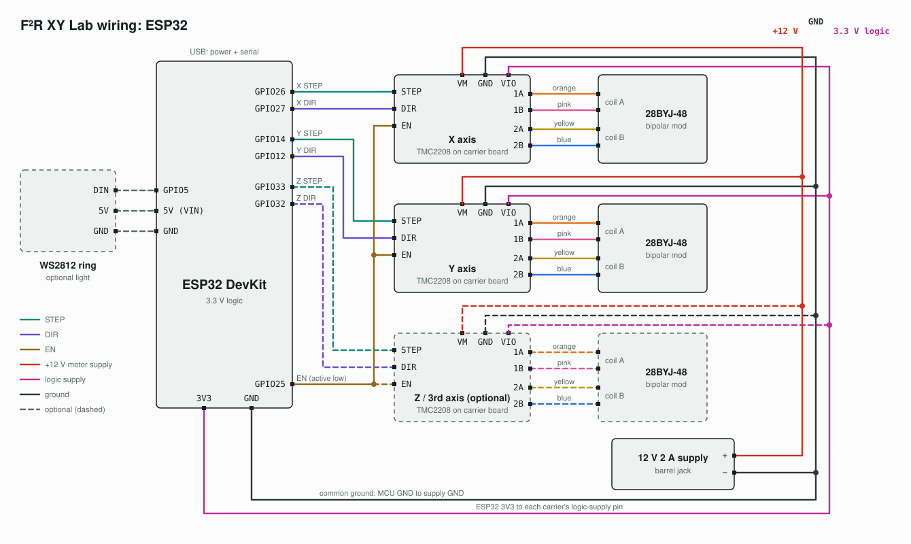
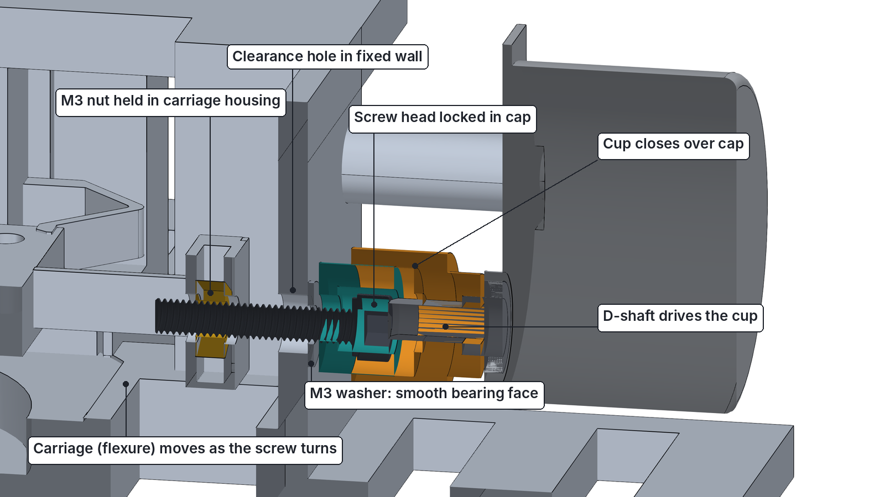

# F²R XY Flexure Stages

Open design files for the **F²R (Fiction to Reality)** 3D-printed XY positioning stages: compliant (flexure) mechanisms driven by low-cost stepper motors, built to bring nanometre-scale positioning to labs, classrooms and makers at a fraction of the cost of commercial stages.



*Full-quality video: [xy-lab-assembly.mp4](assembly/xy-lab-assembly.mp4)*



**Building an XY Lab? Follow the illustrated [Assembly Guide](ASSEMBLY.md).**

> **Licence:** F²R Hardware License v1.0. Personal, educational, experimental and non-commercial research use is permitted with attribution. Commercial manufacture, sale or use requires prior written permission from F²R. See [`LICENSE.pdf`](LICENSE.pdf).

---

## Contents

1. [Which stage is which](#which-stage-is-which)
2. [Repository files](#repository-files)
3. [Performance](#performance)
4. [Bill of materials](#bill-of-materials)
5. [Step 1 — Print the parts](#step-1--print-the-parts)
6. [Step 2 — Convert the motors to bipolar](#step-2--convert-the-motors-to-bipolar)
7. [Step 3 — Wire the electronics](#step-3--wire-the-electronics)
8. [Step 4 — Set the driver current and microstepping](#step-4--set-the-driver-current-and-microstepping)
9. [Step 5 — Assemble the stage](#step-5--assemble-the-stage)
10. [Step 6 — First motion test](#step-6--first-motion-test)
11. [Troubleshooting](#troubleshooting)
12. [Buying a pre-assembled stage](#buying-a-pre-assembled-stage)
13. [Attribution and contact](#attribution-and-contact)

---

## Which stage is which

| Stage | File | Notes |
|---|---|---|
| **XY One** (original) | `XY STAGE 1.step` | First F²R stage; the one that demonstrated sub-20 nm steps. |
| **XY One** (revised) | `XY STAGE UPDATED.step` | Updated revision of XY One. Use this one if you are building XY One. |
| **XY Lab** (current) | `XY Lab.step` | Follow-on model. Drives the flexures through a leadscrew, with the flexure itself providing the preload. M3 mounting holes on the fixed frame and a 9-hole moving platform. |

If you are building one for the first time, **start with XY Lab**.

## Repository files

| File | What it is |
|---|---|
| `XY Lab.step` | Full XY Lab assembly: printed parts, motors and hardware in place |
| `XY STAGE 1.step` | CAD for the original XY One |
| `XY STAGE UPDATED.step` | CAD for the revised XY One |
| `ASSEMBLY.md` + `assembly/` | Illustrated XY Lab assembly guide and its images |
| `Electronics and parts.pdf` | Original parts list with purchase links |
| `wiring/` | Circuit diagrams for the Arduino Nano and ESP32 versions |
| `firmware/` | Stage firmware for the Arduino Nano and ESP32 versions |
| `software/` | Web controller (Python) for jogging and repeatability testing |
| `LICENSE.pdf` / `LICENSE.docx` / `F2R Hardware License v1.0.docx` | Licence text |

`.step` files open in FreeCAD, Fusion 360, Onshape, SolidWorks and most other CAD tools. Export each body to STL (or 3MF) for slicing.

## Performance

Measured on XY One:

- **First validation (4 July 2026):** under a microscope against a lithographed wafer with 4 µm-spaced bars, counting single-step taps needed to cross a 4 µm gap gave **< 20 nm per step**, repeated over many runs.
- **Optical tracker metrology:** ~8.4 nm resolved microstep, ~0.6 nm measurement noise floor, and a **~210 nm repeatable minimum increment** (25 microsteps per command: mean 210.5 nm, CV 0.13, no backward steps).

The difference between *resolved* and *repeatable* matters: single microsteps can be resolved, but at that scale the stage shows dead steps and occasional retrograde steps (stiction / motor detent torque). For reliable positioning, command moves in groups of microsteps.

---

## Bill of materials

Quantities are for a complete stage with its electronics. Links are in `Electronics and parts.pdf`.

### Mechanical (XY Lab)

| Qty | Part | Notes |
|---|---|---|
| 1 | Stage body (printed) | One print: frame, flexures and moving platform |
| 2 | Coupler cap (printed) | Holds the lead-screw head |
| 2 | Coupler cup (printed) | Fits the motor's D-shaft and closes over the cap |
| 2 | M3 × 16 socket head cap screw | Lead screws |
| 2 | M3 hex nut | Captured in the stage's nut housings |
| 2 | M3 washer (DIN 125, 0.5 mm thick) | Between the fixed wall and each coupler cap, for smooth rotation |
| — | Plastic-safe grease (PTFE or silicone) | Lead-screw thread and washer faces |
| 4 | M3 × 10 socket head cap screw | Motor mounting |
| — | **PETG filament** | PETG only. PLA creeps and fatigues in flexures. |

### Electronics

| Qty | Part | Notes |
|---|---|---|
| 2 | 28BYJ-48 5 V stepper motors | One per axis. Must be converted to bipolar (Step 2). |
| 2 | TMC2208 stepper driver modules | One per motor |
| 2 | Stepper driver expansion boards (A4988-style carrier) | One per driver; makes wiring and microstep jumpers easy |
| 1 | Arduino Nano (or ESP32) | Controller |
| 1 | 12 V, 2 A DC power supply | Plus a barrel-jack connector |
| — | Jumper wires | |
| optional | WS2812 LED ring or any light source | Illumination if you use the stage under a microscope |

---

## Step 1 — Print the parts

1. Open the `.step` file for your stage and export each printed body to STL/3MF.
   For **XY Lab**, print **1 × stage body, 2 × coupler cap and 2 × coupler cup**. The motors and screws in the file are there for reference only.
2. Print in **PETG**. The flexures rely on PETG's toughness and fatigue resistance.
3. Suggested starting point (tune for your printer):
   - Print the main body **flat on the bed**, in the orientation it appears in the CAD file, so the flexure hinges are formed by in-plane perimeters rather than stacked layers.
   - 0.2 mm layer height, 0.4 mm nozzle.
   - Enough walls that the thin flexure sections print as **solid perimeters with no infill**.
   - Slow down outer walls for clean, consistent hinge thickness.
4. After printing, check that every flexure hinge is intact and free of strings or blobs. A cracked or uneven hinge will cause drift and uneven motion.

## Step 2 — Convert the motors to bipolar

The 28BYJ-48 is sold as a unipolar motor. Converting it to bipolar lets it run on the TMC2208 with microstepping and gives noticeably more precise motion.

1. Pop off the small blue plastic cover on the motor.
2. Cut the PCB trace connected to the **red (centre-tap) wire**, so the two half-coils of each phase are joined in series.
3. Leave the red wire disconnected. The motor now has two coils on four wires:
   - **Coil A:** orange + pink
   - **Coil B:** yellow + blue
4. Check with a multimeter: orange–pink and yellow–blue should each show a resistance; orange–yellow should be open circuit.

Video walkthrough: <https://www.youtube.com/watch?v=pOMRzBdshEY&t=94s>

## Step 3 — Wire the electronics

> ⚠️ Never connect or disconnect a motor while the driver is powered. It can destroy the TMC2208.

1. Plug each TMC2208 into an expansion board. Match the module's **EN** pin to the board's EN position (check the pin labels; do not go by orientation alone).
2. Connect the 12 V supply to each expansion board's power input. Observe polarity.
3. Connect each motor to its board's motor header: **coil A → 1A/1B, coil B → 2A/2B**. If a motor vibrates but doesn't turn, swap the two wires of *one* coil.
4. Connect the controller to each board. Pin map for both controller options (change it in your firmware if needed):

| Signal | Arduino Nano | ESP32 |
|---|---|---|
| X STEP / DIR | D2 / D3 | GPIO26 / GPIO27 |
| Y STEP / DIR | D4 / D5 | GPIO14 / GPIO12 |
| Z / 3rd STEP / DIR (optional) | D6 / D7 | GPIO33 / GPIO32 |
| EN (shared by all drivers, LOW = on) | D8 | GPIO25 |
| Light ring data (optional) | A0 | GPIO5 |
| Logic supply to each board | 5V | 3V3 |

5. Connect controller **GND to the 12 V supply GND** (common ground), and the controller's logic voltage to each board's logic-supply pin: **5V on the Nano, 3V3 on the ESP32**. On the ESP32, use 3V3 rather than 5 V so the TMC2208 inputs switch reliably at 3.3 V levels.
6. Power the controller from USB while testing. The 12 V supply feeds only the boards' motor input.

**Arduino Nano**



**ESP32**



Notes:

- Board pin names differ between carrier boards. Wire by the label printed on your board (commonly E / S / D / G for the control header and 5V / GND / 12–24V for power), not by position in the drawing.
- GPIO12 (Y DIR) is an ESP32 boot-strapping pin. Nothing may pull it high at power-up, or the ESP32 will not boot.
- The third axis and the light ring are optional and drawn dashed.

## Step 4 — Set the driver current and microstepping

**Current (Vref).** Before connecting the motors, power the board and turn the TMC2208's trim potentiometer while measuring the voltage between the pot and GND.

- Start low, around **0.3–0.4 V**. The bipolar-converted 28BYJ-48 has high coil resistance, so it does not need much current.
- Run the motor for a few minutes and check it stays only warm to the touch. Increase Vref slightly only if it skips steps.

**Microstepping.** In standalone mode the TMC2208's MS1/MS2 pins set the microstep mode (set by the jumpers on the expansion board):

| MS1 | MS2 | Mode |
|---|---|---|
| low | low | 1/8 (default, no jumpers) |
| high | low | 1/2 |
| low | high | 1/4 |
| high | high | 1/16 |

Use **1/16** for the finest motion. Check your module's pin labels, since TMC2208 carriers differ.

## Step 5 — Assemble the stage

**Full illustrated instructions: [ASSEMBLY.md](ASSEMBLY.md).**



In short, for each axis:

1. Drop an M3 nut into the nut housing in the moving carriage.
2. Put an M3 × 16 screw into the coupler cap, head inside, and slide an M3 washer onto the shank against the cap.
3. Thread the screw through the fixed wall into the nut until the washer just touches the wall, with the cap still turning freely.
4. Push the coupler cup onto the motor's D-shaft.
5. Slide the motor in so the cup closes over the cap, and screw the motor tabs to the standoffs with two M3 × 10 screws.

> **Grease:** put a small dab of plastic-safe grease (PTFE or silicone) on the lead-screw thread and on both faces of the washer. It makes the motion smoother and quieter and reduces wear on the printed parts. Use only a thin film: too much collects dust and can creep onto the flexures.

Then bolt the slotted feet to a breadboard with M6 screws. Mount any optics to the breadboard, **not to the stage**, so motor vibration does not reach them.

## Step 6 — First motion test

Upload this minimal sketch to the Nano. It moves the X axis forward and back by a fixed number of microsteps. On an ESP32, change the three pins to 26, 27 and 25.

```cpp
// Minimal STEP/DIR test for one axis (X). Adjust pins to your wiring.
const int STEP_PIN = 2;
const int DIR_PIN  = 3;
const int EN_PIN   = 8;

const int STEPS        = 25;   // microsteps per move (~210 nm repeatable increment on XY One)
const int STEP_DELAY_US = 800; // lower = faster

void move(int steps, bool forward) {
  digitalWrite(DIR_PIN, forward ? HIGH : LOW);
  for (int i = 0; i < steps; i++) {
    digitalWrite(STEP_PIN, HIGH);
    delayMicroseconds(STEP_DELAY_US);
    digitalWrite(STEP_PIN, LOW);
    delayMicroseconds(STEP_DELAY_US);
  }
}

void setup() {
  pinMode(STEP_PIN, OUTPUT);
  pinMode(DIR_PIN, OUTPUT);
  pinMode(EN_PIN, OUTPUT);
  digitalWrite(EN_PIN, LOW); // LOW enables the TMC2208
}

void loop() {
  move(STEPS, true);
  delay(1000);
  move(STEPS, false);
  delay(1000);
}
```

Then:

1. Power the 12 V supply, then the Nano.
2. Watch the platform under a microscope or with a dial indicator. It should step back and forth once a second.
3. To check resolution yourself, image a known feature (a calibration slide or a lithographed pattern) and count steps needed to cross a known distance.

### Full stage firmware

Once the test works, upload the full firmware for your controller. Both versions use the pin map in Step 3 and the same serial commands.

| Controller | Sketch |
|---|---|
| Arduino Nano | [`firmware/xy_lab_nano/xy_lab_nano.ino`](firmware/xy_lab_nano/xy_lab_nano.ino) |
| ESP32 | [`firmware/xy_lab_esp32/xy_lab_esp32.ino`](firmware/xy_lab_esp32/xy_lab_esp32.ino) |

Install **AccelStepper** and **Adafruit NeoPixel** from the Arduino Library Manager first. Open the serial monitor at **115200 baud** and send one command per line:

| Command | Action |
|---|---|
| `R` / `L` | X axis forward / back |
| `U` / `D` | Y axis forward / back |
| `+` / `-` | 3rd axis forward / back (optional axis) |
| `1` / `0` | Light ring on / off |

Jog commands must be resent continuously (for example while a key is held). If no command arrives for 350 ms, all axes stop and the drivers are disabled so the motors stay cool. Change `motorSpeed` at the top of the sketch to set the jog speed in steps per second.

### Web controller (ESP32)

[`software/stage_controller.py`](software/stage_controller.py) is a browser-based controller with a live camera view. It has:

- a D-pad, keyboard arrows, focus (Z) buttons and exact microstep moves
- live nm-per-step estimates
- tuning for cross-axis (diagonal) compensation
- a repeatability test suite: bidirectional, unidirectional, staircase, XY square closure and drift runs
- timestamped CSV logs for lining up with Tracker video

It needs its own firmware, [`firmware/web_controller_esp32/web_controller_esp32.ino`](firmware/web_controller_esp32/web_controller_esp32.ino) (ESP32 only), which adds precision moves, move acknowledgements and a hard halt on top of the jog commands above.

1. Flash `web_controller_esp32.ino` to the ESP32 (same libraries as above).
   - The firmware drives the Y driver's EN from **GPIO4**, not the shared GPIO25 in Step 3. Either wire the Y carrier's EN to GPIO4, or change `EN_PIN_Y` to `25` at the top of the sketch if you used the shared-EN wiring.
2. Install Python 3 and the requirements:

   ```
   pip install -r software/requirements.txt
   ```

3. At the top of `stage_controller.py`, set `SERIAL_PORT` (for example `COM4` on Windows or `/dev/ttyUSB0` on Linux) and `CAM_INDEX` (0 = built-in camera, 1 = USB microscope camera).
4. Run `python software/stage_controller.py` and open <http://localhost:5002>. Other devices on the same network can use `http://<this-computer's-IP>:5002`.

The microstep setting in the page (default 1/16) only scales the nm figures. It must match the MS1/MS2 jumpers on the carriers (Step 4).

> The web page has no login. Anyone on the same network can move the stage, so run it only on a network you trust.

## Troubleshooting

| Symptom | Likely cause | Fix |
|---|---|---|
| Motor hums or vibrates but doesn't turn | Coil wires paired wrongly | Recheck pairs with a multimeter; swap the two wires of one coil |
| Motor doesn't move at all | EN not pulled low, no 12 V, or no common ground | Check EN pin, supply, and Nano GND ↔ supply GND |
| Motor gets hot | Vref too high | Lower Vref |
| Skipped steps / stalls | Vref too low or stepping too fast | Raise Vref slightly or increase `STEP_DELAY_US` |
| Single microsteps sometimes do nothing or go backward | Normal at this scale (stiction / detent torque) | Command moves in groups of microsteps (e.g. 25) |
| Rough, jerky or squeaky motion | Dry lead-screw thread or washer | Add a thin film of plastic-safe grease (PTFE or silicone) to the thread and washer faces |
| Platform drifts over time | Flexure creep, wrong material, or damaged hinge | Use PETG, inspect hinges, allow settling time after large moves |
| Image shakes while moving | Optics mounted to the stage | Mount optics to the base, not to the stage |

## Buying a pre-assembled stage

A pre-assembled **XY Lab** with electronics (Arduino Nano or ESP32) is available from [f2r.site](https://f2r.site). The 12 V power supply is not included.

## Attribution and contact

If you build, modify or share this design, credit **F²R (Fiction to Reality)**, link back to this repository, and clearly state what you changed. Modified designs must not be presented as official F²R designs.

For commercial licensing or questions, reach out via [f2r.site](https://f2r.site) or open an issue in this repository.

© 2026 Atharv Dubey / F²R
